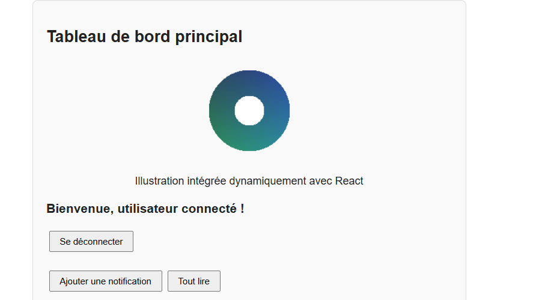
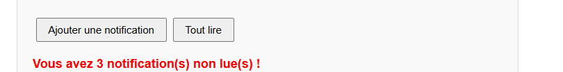
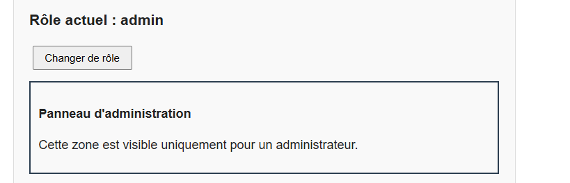
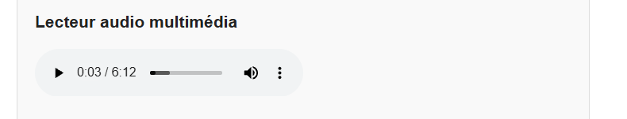

# TP 3 : Navigation, rendu conditionnel et intégration des ressources dans React

> **Réalisé par :** OUADAY Sara

## Objectifs

- Configurer React Router pour la navigation multi-pages.
- Utiliser le rendu conditionnel (ternaire et `&&`).
- Générer des listes dynamiques avec `map()`.
- Intégrer des images et un lecteur audio.

## Structure

```
src/
├── Accueil.js
├── Apropos.js
├── Contact.js
├── AdminPanel.js
├── App.css
├── App.js
├── Connexion.js
├── Entete.js
├── LecteurAudio.js
├── ListeTaches.js
├── Logo.js
├── Notification.js
├── logo.png
├── index.css
└── index.js
```

## Navigation (React Router)

`BrowserRouter` enveloppe `App` dans `index.js`. `Routes`, `Route` et `Link` définissent les pages Accueil, À propos et Contact.

## Rendu conditionnel

### Connexion (ternaire)



### Notification (`&&`)



### AdminPanel (exercice 1)

Le panneau n'apparaît que si le rôle vaut `admin`.



## Liste dynamique (exercice 2)

La liste des tâches est stockée dans un état `useState`. Un formulaire permet d'en ajouter.


## Médias



## Page Contact (exercice 3)

Formulaire contrôlé avec message de confirmation.


## Conclusion

- React Router permet une navigation sans rechargement de page.
- Le rendu conditionnel affiche des éléments selon l'état.
- `map()` avec une `key` unique génère des listes dynamiques.
- Les images et l'audio s'intègrent comme des composants.
